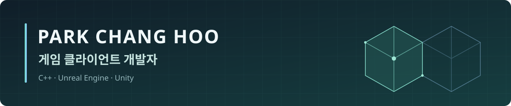
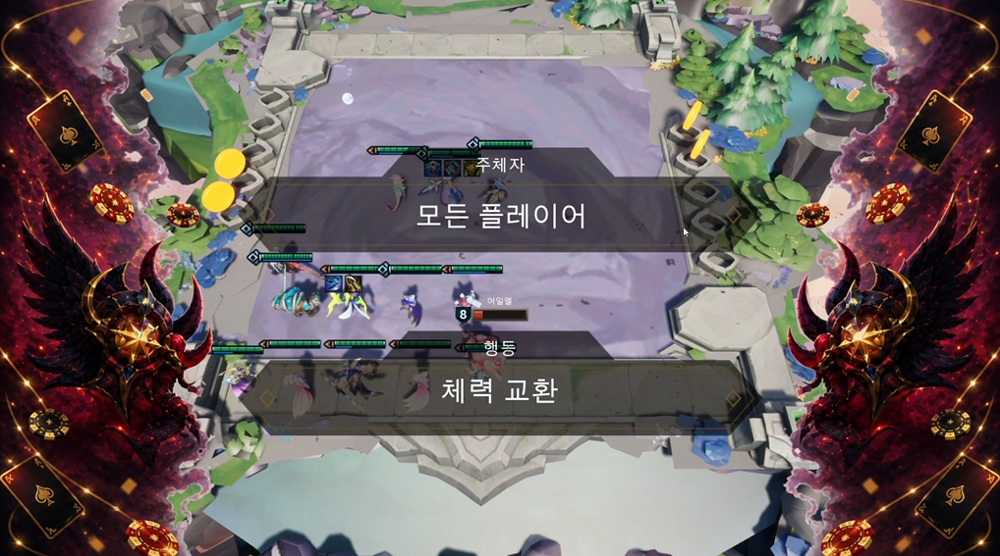
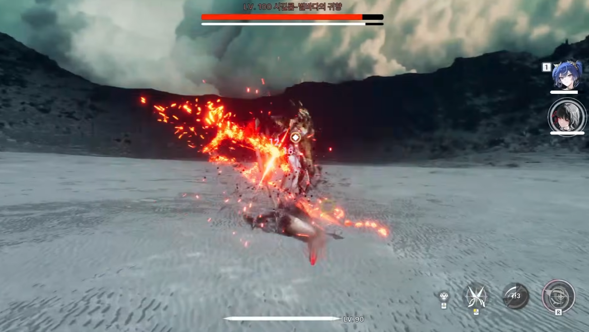
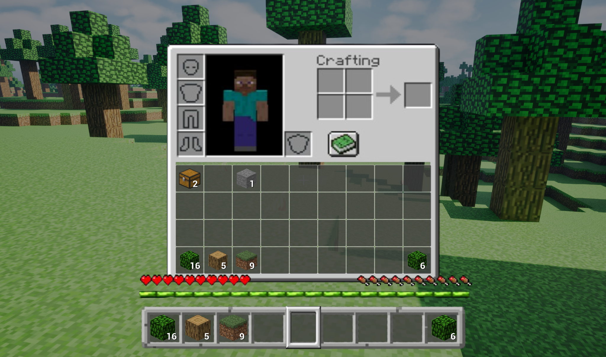

   

[이메일](mailto:pencil0303@naver.com) · [개발 블로그](https://hoo2001.tistory.com/) · [시연 영상 모음](https://www.youtube.com/@changhoo01/videos)

## 소개

안녕하세요. **Unreal Engine과 C++를 중심으로 클라이언트를 개발하는 박창후**입니다.

게임의 규칙과 데이터가 플레이어의 화면에 어떻게 전달되는지 고민하며 개발합니다. TFT 모작에서는 전용 서버 기반 게임 흐름과 상태 동기화를, 명조 모작에서는 공통 능력치 구조와 전투 UI를, Minecraft 모작에서는 데이터 기반 블록 관리와 인벤토리를 구현했습니다.

SLZ 디지털 트윈스 팀에서 Unreal Engine 시각화 기능을 개발한 경험이 있습니다. 문제가 생기면 객체의 역할과 데이터 갱신 흐름을 따라 원인을 찾고, 수정 과정과 결과를 블로그와 시연 영상으로 기록합니다.

현재는 3인칭 소울라이크 팀 프로젝트 Maverick에서 보스 AI와 공격 패턴, 화면 전환을 개발하며 전투 흐름과 피드백을 개선하고 있습니다.

## 진행 중인 프로젝트

### [매버릭 · Maverick](https://github.com/DreamersStudio3/Maverick)

**개발 중 · Unreal Engine 5.8 · C++ · Blueprint · 팀 프로젝트**

3인칭 소울라이크 게임을 제작하고 있습니다. 아래는 프로젝트에서 담당한 작업과 현재 개선하고 있는 내용입니다.

- **StateTree 기반 적 AI**: 대기·탐색·추적·공격·사망 상태를 구성하고, AI Task와 전투 액션을 연결했습니다. 공격 예고 이벤트와 대상 회전도 연동했습니다.
- **보스 공격 패턴**: 튜토리얼 보스의 DataTable 기반 공격 선택과 랜덤 공격을 구현했습니다. 현재 Duelist 보스의 거리별 공격 선택과 교대 패턴을 개선하고 있습니다.
- **보스 스킬과 전투 피드백**: Duelist의 사슬 발사·끌어오기 스킬을 구현하고, Animation Montage·AnimNotify로 실행 시점과 판정을 연결했습니다. 보스 정보 UI와 공격 범위 표시를 연동하며 동작을 확인하고 있습니다.
- **화면 전환**: 레벨 전환의 로딩 화면과 화면 전환 흐름을 구현하고, 관련 전투 상태와 UI 연동을 수정했습니다.

[프로젝트 저장소](https://github.com/DreamersStudio3/Maverick) · [개발 기록 1](https://hoo2001.tistory.com/64) · [개발 기록 2](https://hoo2001.tistory.com/67) · [개발 기록 3](https://hoo2001.tistory.com/73)

## 대표 프로젝트

이미지를 클릭하면 시연 영상으로 이동합니다. 각 카드 아래에서 시연 영상, 개발 기록과 회고록을 확인할 수 있습니다. 아래 내용은 각 프로젝트에서 제가 담당한 작업입니다.

<table>
  <tr>
    <td width="33%" align="center" valign="top">
      
       <b>TFT 모작 · LTF</b>
       UE 5.6 · C++ · 5인 팀
       2026.06.30 — 2026.07.13
        전용 서버 게임 루프 로비 전환 · 룰렛 · HUD
        <b>포텐업 최종 프로젝트 최우수상</b>
        <a href="https://github.com/LTF-UTF/LTF">저장소</a> · <a href="https://www.youtube.com/watch?v=5CpVqWKCEx4">시연 영상</a>
       <a href="https://hoo2001.tistory.com/62">개발 기록</a> · <a href="https://oasis-alloy-d6e.notion.site/LTF-3b26d02f3953803689bae6cf72957a61?pvs=73">회고록</a>
    </td>
    <td width="33%" align="center" valign="top">
      
       <b>명조 모작</b>
       UE 5.6 · C++ · 3인 팀
       2026.05.06 — 2026.05.27
        Stat Component · 전투 UI 보스전 연출 · 월드 구성
        <a href="https://github.com/pch2001/Myeongjo">저장소</a> · <a href="https://www.youtube.com/watch?v=9skfkhyv1f4">시연 영상</a>
       <a href="https://hoo2001.tistory.com/61">개발 기록</a> · <a href="https://oasis-alloy-d6e.notion.site/3b76d02f395380adae71d0f26abe784b?pvs=73">회고록</a>
    </td>
    <td width="33%" align="center" valign="top">
      
       <b>Minecraft 모작</b>
       UE 5.6 · Blueprint · 개인
       2026.03.24 — 2026.04.06
        ISM 기반 블록 관리 DataTable · 인벤토리 · 핫바
        <a href="https://github.com/pch2001/Minecraft">저장소</a> · <a href="https://www.youtube.com/watch?v=8Dv6HJHVmgk">시연 영상</a>
       <a href="https://hoo2001.tistory.com/47">개발 기록</a> · <a href="https://oasis-alloy-d6e.notion.site/3a76d02f395380efa241f3edff860343?pvs=74">회고록</a>
    </td>
  </tr>
</table>

## 프로젝트 이력

### 🎮 2026 · Unreal Engine과 C++ 시스템 개발

- [**매버릭 · Maverick (개발 중)**](https://github.com/DreamersStudio3/Maverick) — StateTree 기반 적 AI, 보스 공격 패턴·사슬 스킬, 로딩 화면과 화면 전환
- [**TFT 모작**](https://github.com/LTF-UTF/LTF) — 전용 서버 게임 루프, 로비 전환, 룰렛, HUD 구현 · 최우수상
- [**명조 모작**](https://github.com/pch2001/Myeongjo) — 능력치 컴포넌트, 전투 UI, 시퀀스, 월드 구성
- [**Minecraft 모작**](https://github.com/pch2001/Minecraft) — Blueprint 기반 블록 조작, ISM, 인벤토리
- [**이스라엘 디펜스 · C++ 콘솔 게임**](https://www.youtube.com/watch?v=bPuzSlUIzpk) — A* 경로 탐색, 충돌·피격 처리, 라운드와 상점 시스템 · 2026.02 / 2026.03 · [개발 기록](https://hoo2001.tistory.com/37)
- [**C++ 콘솔 엔진 · Hoo_ConsoleEngine**](https://github.com/pch2001/Hoo_ConsoleEngine) — 컴포넌트 기반 물리, 충돌 레이어, 레벨 관리 구현

### 🥽 2025 · 멀티플레이와 직무 경험

- [**인생게임 · 캡스톤 디자인**](https://github.com/Jinmiru/sw-capstone-design) — UE 5.4 · 3인 개발팀 · 2025.02 — 2025.06 MetaHuman 성장 단계별 외형 변화, 직업 5종 스킬, 전용 서버와 HUD 구현 · SW 캡스톤 디자인 경진대회 동상 · [시연 영상](https://www.youtube.com/watch?v=R9aDqsHigTw&t=26s)
- [**MaCook · 메이플스토리 직무 멘토링**](https://github.com/pch2001/MaCook) — 2025.08.22 — 2025.08.25 메이플스토리 IP의 글로벌 진출을 주제로 Unity 프로토타입 개발 · [시연 영상](https://www.youtube.com/watch?v=Jda-X0ziyTk)

### 🌱 2024 — 2025 · 게임 개발과 팀 운영

- [**BreathLine · 창업동아리 GR팀**](https://github.com/pch2001/BreathLine) — Unity · 8인 팀 · 2024.03 — 2025.09 사회적 메시지를 담은 2D 기능성 게임의 플레이어 스크립트·최종 보스·시나리오 구조 개발. 팀 대표로 주간 회의, 일정 관리, 캐릭터 아트 외주 조율과 전시·공모전 참여 진행 · [시연 영상](https://www.youtube.com/watch?v=r_FlLbikoHo)

### 🌱 2024 · 게임 개발

- [VR ZombieGame](https://www.youtube.com/watch?v=VV8J4VAQezw) - Unity 개인프로젝트
- [AR Hookemon](https://www.youtube.com/shorts/UTA-18j7ypg) - Unity 개인프로젝트
- [LOL 동물특공대](https://www.youtube.com/watch?v=VV8J4VAQezw) - Unreal 개인 프로젝트
- [MonsterHunter](https://www.youtube.com/watch?v=G9nH8kRrGDM) - Unity · 2인 팀, 2/3일 해커톤

---

개발 과정과 문제 해결 기록은 [블로그](https://hoo2001.tistory.com/)에, 프로젝트 실행 결과는 [YouTube 시연 영상 모음](https://www.youtube.com/@changhoo01/videos)에 정리하고 있습니다.
